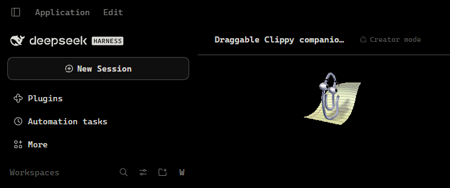
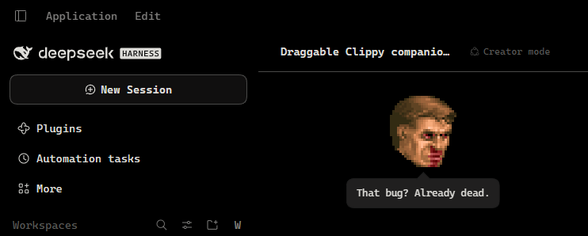

# Clippy Companion for DSH

**English** · [Русский](README.ru.md)

A draggable companion that lives inside the DeepSeek Harness chat area, with
switchable sprite packs. Two packs ship in the box: **Clippy** (OpenClippy
sprites) and **Doomguy** (DOOM II status-bar faces, meme faces included). The
drag area is measured from the conversation column itself, so the companion
stays out of the sidebar and the presented-files panel and follows layout
changes (sidebar collapse, right panel, window resize, composer growth).

| Clippy | Doomguy |
| --- | --- |
|  |  |

## Features

- **Draggable.** Grab the companion and move it anywhere inside the chat column.
  The position is clamped to that column and saved in `localStorage`, so it
  survives reloads and adapts to a resized window.
- **Presets.** Right-click the companion (or long-press on touch) to switch
  between packs, or use **Settings → General → Companion**. The choice is
  remembered.
- **Per-preset voice.** Idle loops, greetings, reactions and the random lines
  all come from the pack's `preset.json`, including its own set of comments.
- **Context damage.** The DOOM pack reads the live context pressure from the
  token meter and picks a beaten-up variant of the current face once the window
  fills: healthy below 35%, wounded from 35%, badly hurt from 65%. When no
  bloodied variant exists the healthy frame stays.
- **Meme faces.** The pack also carries 22 high-res Reddit meme faces, scaled
  down to the same 24×29 face size. Some have their own quote; otherwise one
  shows up at random between idle animations.
- **Animated.** Idle loops, a greeting on load, and a reaction for every
  comment, all played at the frame durations declared by the sprite manifest.
- **Talkative.** Click the companion (or press Enter while it has focus) to get
  a short comment in a themed speech bubble.
- **Keyboard accessible.** Focus the companion with Tab, move it with the arrow
  keys (hold Shift for bigger steps), speak with Enter or Space, open the preset
  menu with the Menu key or Shift+F10, dismiss with Escape.
- **Theme-aware.** The speech bubble, menu and settings row use the host theme
  tokens; only the artwork keeps its own colours.
- **Reduced motion.** `prefers-reduced-motion: reduce` keeps the companion in its
  rest frame instead of looping animations.

## Install

The package is a normal pnpm dependency, so a GitHub ref or a local checkout
both work. In the Desktop app, use the **Plugins** page; from a shell (Windows,
Linux, macOS):

```sh
# from GitHub
dsh plugin --profile desktop add github:extreme-russian-dsh-fandom/dsh-clippy-companion

# from a local checkout
dsh plugin --profile desktop add C:\path\to\dsh-clippy-companion

# same on Linux or macOS
dsh plugin --profile desktop add /path/to/dsh-clippy-companion
```

Replace `desktop` with your profile name (`web`, `tui`, ...). `dsh plugin`
forwards its arguments to pnpm, so `github:` is pnpm's GitHub shorthand; append
`#<branch-or-commit>` to pin a revision. Repository:
<https://github.com/extreme-russian-dsh-fandom/dsh-clippy-companion>.

Installing a local directory links it, so later edits need only a plugin
re-enable. Installing the GitHub spec copies the package: push first, then
reinstall to pick up changes. No build step is needed.

Restart the Harness, then reload the page. The plugin appears as **Clippy
Companion** in the Plugins settings.

## Uninstall

Remove the bundle in the Harness **Plugins** page, or:

```sh
dsh plugin --profile desktop remove @local/dsh-clippy-companion
```

## Preset packs

Each pack is a directory under `assets/` with the following files:

```
assets/<pack>/
  preset.json        pack descriptor (see below)
  sprite-data.json   frameWidth, frameHeight, animations[{duration, position}]
  <sheet>.png        sprite sheet referenced by preset.json
  LICENSE | LICENSE.md
```

`preset.json`:

```json
{
  "id": "openclippy",
  "version": 1,
  "sprite": "clippy-map.png",
  "manifest": "sprite-data.json",
  "scale": 1,
  "pixelated": false,
  "greeting": "Greeting",
  "rest": "RestPose",
  "idle": ["Idle1_1", "LookLeft", "..."],
  "speech": [{ "key": "clippy.line1", "anim": "Thinking" }]
}
```

- `scale` multiplies frame size and background position; `pixelated` switches
  on nearest-neighbour rendering for pixel art.
- `version` cache-busts the sprite and manifest URLs. Bump it whenever a pack's
  images change, otherwise the browser keeps the old sheet for its cache
  lifetime (`preset.json` itself is always fetched fresh).
- `greeting` plays once after load, `rest` is used for reduced motion and as a
  fallback, `idle` is sampled at random between pauses, and `speech` maps a
  locale key to a reaction animation.
- Optional `memeIdle` (animation names) and `memeChance` (0–1) make an idle loop
  occasionally show a random joke face instead of the regular idle set.
- Damage variants are ordinary manifest animations suffixed by tier:
  `Angry`, `AngryHurt`, `AngryBad`. The client prefers the highest tier that
  exists for the requested base name.
- Add a pack by dropping its directory under `assets/` and adding one row to
  `PRESETS` in `client.js`. No Host change is needed: the asset route is a
  prefix over the whole directory.

## Rebuilding the DOOM pack

```
python tools/build-doom-pack.py
```

The script keys the classic sheet, flood-fills the meme sheets' black
backgrounds, scales meme faces into 24×29, packs every frame into 32×32 cells,
and writes `faces.png` plus the damage-tier manifest. Run it from the repository
root after changing any of the source sheets.

The classic sheet stores five health levels per expression (100/80/60/40/20
percent), and the three damage tiers use 100/60/20. The build asserts that no
generated animation mixes health levels, so a clip never changes bloodiness
partway through.

## How it works

- `index.js` (Host) exposes `assets/` read-only on
  `/clippy-companion/assets/<pack>/...`, with traversal, extension and content
  type checks.
- `client.js` (Client) registers a hidden probe in `conversation.input.dock`
  that measures the chat column and forwards the `contextPressure` projection,
  the companion in `shell.overlay`, and a preference row in
  `settings.general.item`.
- Sprite frames are drawn by shifting `background-position` on the single
  sheet; timings come straight from each pack's `sprite-data.json`.

## Layout of the package

```
index.js            Host half: read-only asset route
client.js           Client half: probe, companion, presets, menu, settings row
cordis.patch.yml    Bundle patch inserting the plugin row
locale/             Plugin-manager display metadata (en, ru, zh)
icon.png            Plugin icon cropped from the sprite sheet
media/              README screenshots (Clippy and Doomguy)
assets/openclippy/  clippy-map.png + sprite-data.json + MIT licence
assets/doom/        faces.png + sprite-data.json + classic + meme source sheets
tools/              build-doom-pack.py (regenerates the DOOM sheet + manifest)
```

## Licence

Plugin code: MIT, see [LICENSE](LICENSE).

- `assets/openclippy/`: MIT, © 2026 OpenClippy Contributors, see
  [assets/openclippy/LICENSE](assets/openclippy/LICENSE).
- `assets/doom/`: the DOOM II status-bar faces are © 1994 id Software LLC /
  ZeniMax Media and are **not** covered by the MIT licence. The meme faces come
  from the Reddit posts listed in [assets/doom/LICENSE.md](assets/doom/LICENSE.md);
  that file also records the shareware-distribution note. Review it before
  redistributing this directory or a package that contains it.
