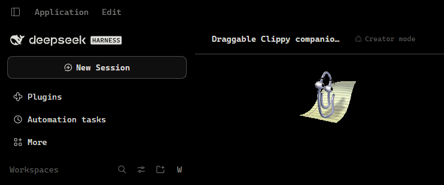
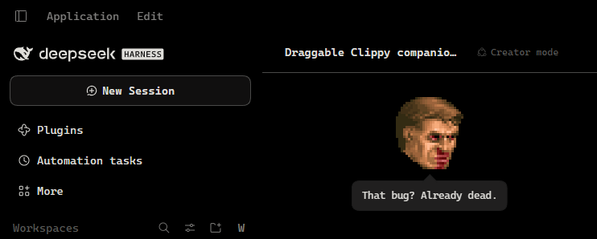

# Клиппи-компаньон для DSH

[English](README.md) · **Русский**

Перетаскиваемый компаньон, который живёт в области чата DeepSeek Harness, со
сменными наборами спрайтов. В комплекте два набора: **Клиппи** (спрайты
OpenClippy) и **Думгай** (лица из статус-бара DOOM II, включая мемные). Область
перетаскивания измеряется по самой колонке чата, поэтому компаньон не заходит в
сайдбар и на панель открытых файлов и следует за изменениями раскладки
(сворачивание сайдбара, правая панель, изменение размера окна, рост композера).

| Клиппи | Думгай |
| --- | --- |
|  |  |

## Возможности

- **Перетаскивание.** Схватите компаньона и перетащите в любое место колонки
  чата. Позиция ограничивается этой колонкой и сохраняется в `localStorage`,
  поэтому переживает перезагрузку и подстраивается под изменённое окно.
- **Пресеты.** Щёлкните правой кнопкой по компаньону (или удерживайте на
  сенсорном экране), чтобы переключить набор, либо используйте
  **Настройки → Общие → Компаньон**. Выбор запоминается.
- **Голос набора.** Циклы простоя, приветствия, реакции и случайные реплики
  берутся из `preset.json` набора, включая собственный набор комментариев.
- **Повреждения от контекста.** Набор DOOM читает текущее давление контекста из
  token meter и выбирает повреждённую версию текущего лица по мере заполнения
  окна: здоровое до 35%, раненое с 35%, сильно повреждённое с 65%. Если
  окровавленного варианта нет, остаётся здоровый кадр.
- **Реакции на агента.** Во время хода компаньон показывает размышление,
  активный инструмент (редактирование, чтение, оболочка или общий), успех или
  ошибку инструмента, ожидание решения и завершение хода. Облачко реплики
  временно перехватывает анимацию, после чего она продолжается.
- **Мемные лица.** В наборе также 22 мемных лица с Reddit, уменьшенных до того же
  размера 24×29. У некоторых есть своя реплика; остальные случайно появляются
  между анимациями простоя.
- **Анимация.** Циклы простоя, приветствие при загрузке и реакция на каждый
  комментарий проигрываются с длительностями кадров из манифеста спрайтов.
- **Разговорчивость.** Нажмите на компаньона (или Enter, когда он в фокусе),
  чтобы получить короткий комментарий в тематическом облачке. Если тыкать
  подряд, он начинает раздражаться; двойной щелчок показывает случайное мемное
  лицо.
- **Сон.** После пяти спокойных минут компаньон засыпает с облачком `Zzz` и
  переключается на анимацию сна, если она есть в наборе. Активность хода,
  щелчок, нажатие клавиши или реплика будят его анимацией пробуждения.
- **Доступность с клавиатуры.** Tab — фокус, стрелки — перемещение (Shift —
  крупнее шаг), Enter или пробел — реплика, клавиша меню или Shift+F10 — меню
  пресетов, Escape — закрыть.
- **Тема.** Облачко, меню и строка настроек используют токены темы хоста;
  собственные цвета остаются только у спрайтов.
- **Уменьшенное движение.** При `prefers-reduced-motion: reduce` компаньон
  остаётся в кадре покоя вместо циклических анимаций.

## Установка

Пакет — обычная зависимость pnpm, поэтому подходят и ссылка на GitHub, и
локальная копия. В приложении Desktop используйте страницу **Plugins**; из
оболочки (Windows, Linux, macOS):

```sh
# из GitHub
dsh plugin --profile desktop add github:extreme-russian-dsh-fandom/dsh-clippy-companion

# из локальной копии
dsh plugin --profile desktop add C:\path\to\dsh-clippy-companion

# то же в Linux или macOS
dsh plugin --profile desktop add /path/to/dsh-clippy-companion
```

Замените `desktop` на имя своего профиля (`web`, `tui`, ...). `dsh plugin`
передаёт аргументы в pnpm, поэтому `github:` — сокращение pnpm для GitHub;
добавьте `#<branch-or-commit>`, чтобы закрепить ревизию. Репозиторий:
<https://github.com/extreme-russian-dsh-fandom/dsh-clippy-companion>.

Установка локального каталога создаёт ссылку, поэтому после правок достаточно
повторно включить плагин. Установка спецификации GitHub копирует пакет: сначала
push, затем переустановка, чтобы подхватить изменения. Сборка не требуется.

Перезапустите Harness и обновите страницу. Плагин появится как **Clippy
Companion** в настройках плагинов.

## Удаление

Удалите бандл на странице **Plugins** в Harness или командой:

```sh
dsh plugin --profile desktop remove @local/dsh-clippy-companion
```

## Пресеты

Каждый набор — каталог в `assets/` со следующими файлами:

```
assets/<pack>/
  preset.json        описание набора (см. ниже)
  sprite-data.json   frameWidth, frameHeight, animations[{duration, position}]
  <sheet>.png        лист спрайтов, на который ссылается preset.json
  LICENSE | LICENSE.md
```

`preset.json`:

```json
{
  "id": "openclippy",
  "version": 1,
  "sprite": "clippy-map.png",
  "manifest": "sprite-data.json",
  "scale": 1,
  "pixelated": false,
  "greeting": "Greeting",
  "rest": "RestPose",
  "idle": ["Idle1_1", "LookLeft", "..."],
  "speech": [{ "key": "clippy.line1", "anim": "Thinking" }],
  "poke": [{ "key": "clippy.poke1", "anim": "Hearing_1" }],
  "pokeMad": { "key": "clippy.pokeMad", "anim": "Alert" },
  "sleep": { "anim": "IdleSnooze" },
  "wake": { "anim": "Hearing_1" }
}
```

- `scale` умножает размер кадра и позицию фона; `pixelated` включает рендеринг
  пиксель-арта методом ближайшего соседа.
- `version` сбрасывает кэш URL спрайта и манифеста. Увеличивайте его при
  изменении изображений набора, иначе браузер будет держать старый лист до
  истечения кэша (сам `preset.json` запрашивается заново всегда).
- `greeting` проигрывается один раз после загрузки, `rest` используется при
  уменьшенном движении и как запасной вариант, `idle` выбирается случайно между
  паузами, а `speech` сопоставляет ключ локали с анимацией реакции.
- Необязательные `memeIdle` (имена анимаций) и `memeChance` (0–1) заставляют цикл
  простоя иногда показывать случайное шутливое лицо вместо обычного набора; этот
  же список используется для мемного лица по двойному щелчку.
- Необязательные `poke` (список `{ key, anim }`) отвечает на щелчок, `pokeMad` —
  на третий щелчок подряд, а `sleep` и `wake` задают анимации сна и пробуждения.
  Отсутствующие записи заменяются подходящими анимациями набора.
- Варианты повреждений — обычные анимации манифеста с суффиксом уровня: `Angry`,
  `AngryHurt`, `AngryBad`. Клиент предпочитает самый высокий уровень, который
  существует для запрошенного базового имени.
- Чтобы добавить набор, положите его каталог в `assets/` и добавьте одну строку в
  `PRESETS` в `client.js`. Изменения Host не нужны: маршрут ассетов — префикс на
  весь каталог.

## Пересборка набора DOOM

```
python tools/build-doom-pack.py
```

Скрипт вырезает классические лица по цветовому ключу, удаляет чёрный фон мемных
листов, уменьшает мемные лица до 24×29, упаковывает каждый кадр в ячейку 32×32 и
записывает `faces.png` вместе с манифестом уровней повреждений. Запускайте его из
корня репозитория после изменения любого исходного листа.

Классический лист хранит пять уровней здоровья для каждого выражения
(100/80/60/40/20%), а три уровня повреждений используют 100/60/20. Сборка
проверяет, что ни одна анимация не смешивает уровни здоровья, поэтому
кровавость не меняется посреди клипа.

## Как это работает

- `index.js` (Host) отдаёт `assets/` только для чтения по
  `/clippy-companion/assets/<pack>/...` с проверками обхода каталога, расширения и
  типа содержимого.
- `client.js` (Client) регистрирует скрытый зонд в `conversation.input.dock`,
  который измеряет колонку чата и передаёт проекцию `contextPressure` и
  активность сессии (ход, активный инструмент, последний результат, ожидание
  ввода), компаньона в `shell.overlay` и строку настроек в
  `settings.general.item`.
- Кадры спрайтов рисуются сдвигом `background-position` по одному листу;
  тайминги берутся напрямую из `sprite-data.json` каждого набора.

## Состав пакета

```
index.js            Host-часть: маршрут ассетов только для чтения
client.js           Client-часть: зонд, компаньон, пресеты, меню, настройки
cordis.patch.yml    патч бандла, добавляющий строку плагина
locale/             метаданные для менеджера плагинов (en, ru, zh)
icon.png            иконка плагина, вырезанная из листа спрайтов
media/              скриншоты для README (Клиппи и Думгай)
assets/openclippy/  clippy-map.png + sprite-data.json + лицензия MIT
assets/doom/        faces.png + sprite-data.json + классический и мемные листы
tools/              build-doom-pack.py (пересобирает лист и манифест DOOM)
```

## Лицензия

Код плагина: MIT, см. [LICENSE](LICENSE).

- `assets/openclippy/`: MIT, © 2026 OpenClippy Contributors, см.
  [assets/openclippy/LICENSE](assets/openclippy/LICENSE).
- `assets/doom/`: лица из статус-бара DOOM II — © 1994 id Software LLC / ZeniMax
  Media, **не** покрыты лицензией MIT. Мемные лица взяты из постов Reddit,
  перечисленных в [assets/doom/LICENSE.md](assets/doom/LICENSE.md); там же
  зафиксировано примечание о shareware-распространении. Ознакомьтесь с ним перед
  распространением этого каталога или пакета, который его содержит.
